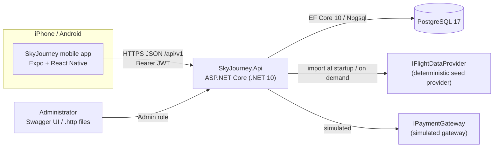
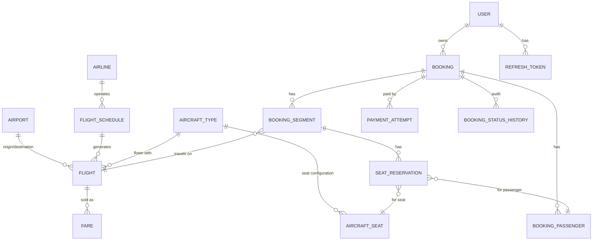
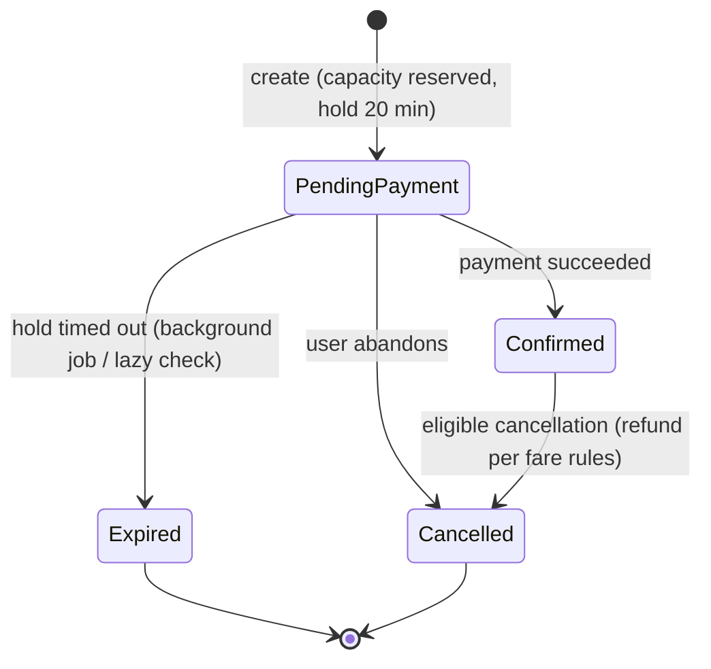

# SkyJourney — Architecture

> Demo application. Airports are real IATA airports, but every airline, flight, fare and
> availability figure is generated by a deterministic mock provider.

## System context



## Backend layering

```
backend/src
  SkyJourney.Domain          entities, value objects, state machines, domain rules (no dependencies)
  SkyJourney.Application     use-case services, DTOs, validators, ports (interfaces)
  SkyJourney.Infrastructure  EF Core DbContext + migrations, Identity, JWT, seed provider, payment simulator, background jobs
  SkyJourney.Api             minimal-API endpoints, auth configuration, ProblemDetails, rate limiting, OpenAPI, composition root
```

Dependencies point inward: `Api → Application → Domain`, and `Infrastructure → Application → Domain`.
`Api` references `Infrastructure` only to wire up dependency injection.

**Pragmatic choices** (see the ADRs):
- Application services take an `ISkyJourneyDbContext` interface that exposes `DbSet<T>`s. There are no
  generic repositories, because EF Core already is a unit of work plus repositories ([ADR-0004](adr/0004-data-access-without-repositories.md)).
- Minimal APIs grouped by feature under `/api/v1`. Endpoints only bind, authorize and call one
  application service method ([ADR-0002](adr/0002-rest-minimal-apis-and-url-versioning.md)).
- Errors use RFC 9457 Problem Details. Domain and application errors map to 400/404/409/422.

## Domain model



| Entity | Notes |
|--------|-------|
| `Airport` | Unique 3-letter IATA code, IANA time zone ID (`Europe/Budapest`), city and country. |
| `Airline` | Fictional operator (`SkyJourney Air`, code `SJ`). |
| `AircraftType` + `AircraftSeat` | The seat configuration: rows × letters, each seat with a category (Standard, Front, ExtraLegroom). |
| `FlightSchedule` | A recurring pattern: flight number, route, local departure time, duration, days of week, validity window. |
| `Flight` | A concrete flight instance: UTC departure and arrival, `DepartureLocalDate` (the origin airport's local date, used by search), capacity, `SeatsSold` counter, status. Unique `(FlightNumber, DepartureLocalDate)`. |
| `Fare` | Per flight and fare family (Basic/Plus/Flex): price (`numeric(10,2)` + ISO currency) and conditions (cabin bag, checked bag kg, free seat selection, refund percentage). |
| `Booking` | Public 6-character reference, owner user ID, status, totals, hold expiry, idempotency key, `xmin` concurrency token. |
| `BookingSegment` | One flight within a booking (Outbound/Return). Holds a **snapshot** of the fare price and conditions at booking time. |
| `BookingPassenger` | Minimal PII: first name, last name, passenger type (Adult/Child). |
| `SeatReservation` | Seat hold or confirmation for passenger × segment. A **partial unique index** on `(flight_id, aircraft_seat_id) WHERE status IN ('Held','Confirmed')` makes double-selling impossible. |
| `PaymentAttempt` | A simulated payment with an idempotency key, status and failure reason. Never stores card data. |
| `BookingStatusHistory` | An append-only audit trail of status transitions. |
| `RefreshToken` | A SHA-256 hash of the opaque token, token family, expiry and revocation (used for rotation and reuse detection). |

### Booking state machine



Payment attempts go `Pending → Succeeded | Failed`. A succeeded payment can then go to `Refunded` or
`PartiallyRefunded` when its booking is cancelled.

### Cancellation rules (enforced in `Booking.Cancel`)
- `PendingPayment` bookings can always be cancelled. Nothing was charged, so nothing is refunded.
- A `Confirmed` booking can be cancelled up to **24 hours before the first departure**.
- The refund for each segment is `fare paid × refund percentage` of its snapshotted fare family:
  Basic 0%, Plus 50%, Flex 100%. Seat fees are refunded only on Flex segments.
- An admin can cancel any active booking with a full refund (for example, when a flight is cancelled).
- Cancelling releases the seats and decrements `Flight.SeatsSold`.

## Concurrency and consistency

| Risk | Control |
|------|---------|
| Overselling flight capacity | An atomic conditional update: `UPDATE flights SET seats_sold = seats_sold + n WHERE id = @id AND seats_sold + n <= capacity`. If no row is affected, the flight is sold out. This runs in the same transaction as the booking insert. |
| The same seat sold twice | A partial unique index on active seat reservations. A violation (`23505`) maps to `409 seat_unavailable`. Expired holds on the flight are released inside the same transaction before new holds are inserted. |
| Payment racing the hold expiry | `Booking` uses PostgreSQL `xmin` as an optimistic concurrency token. The losing transaction gets a `DbUpdateConcurrencyException`, which maps to `409`. |
| Duplicate bookings from retries | The `Idempotency-Key` header is required. There is a unique `(user_id, idempotency_key)` index plus a request hash: the same key with the same body returns the original booking, and the same key with a different body returns `422`. |
| Duplicate payments | `Idempotency-Key` with a unique `(booking_id, idempotency_key)` index. A booking can only be confirmed once. |

## Time handling
- Persisted instants are `timestamptz` (`DateTimeOffset` in UTC).
- Each airport stores an IANA time zone. Schedules store a **local** departure time. A flight's UTC
  departure is computed with `TimeZoneInfo` for that specific date, so DST is handled.
- The API returns both the UTC instant and the airport-local time with its offset
  (`2026-11-02T07:05:00+01:00`), so clients never have to do time-zone math.
- `TimeProvider` is injected everywhere, so tests control the clock.

## Security
- ASP.NET Core Identity handles password hashing and lockout. Access tokens are short-lived JWTs (15 min).
  Refresh tokens are opaque, rotated on every use, and stored only as SHA-256 hashes. Reusing a token revokes the whole family ([ADR-0003](adr/0003-authentication-jwt-and-rotating-refresh-tokens.md)).
- `Admin` role policy for `/api/v1/admin/*`. Admins are provisioned with a CLI command, never through config or an endpoint:
  `dotnet run --project backend/src/SkyJourney.Api -- promote-admin user@example.com` (the account must exist).
  The role reaches existing sessions on their next token refresh.
- The JWT signing key comes from `Jwt__SigningKey` (≥ 32 bytes). Production refuses to start without it. Development
  and tests generate a random per-process key, so access tokens die on restart and clients silently refresh.
- Login failures return the same `401 invalid_credentials` for unknown e-mails and wrong passwords (a dummy hash is
  verified in both cases). Five failures lock the account for 15 minutes (`401 account_locked`). Registration does
  reveal that an e-mail is taken (`409 email_taken`); that is accepted for usability, and the endpoint is rate limited.
- Refresh-token reuse detection is strict: two refreshes racing with the same token count as reuse and end the
  session. The mobile client therefore refreshes single-flight.
- Every booking query is filtered by the authenticated user's ID. Another user's booking returns `404` (no IDOR, no existence leak).
- Prices, totals, status and seat availability are always computed on the server.
- Rate limiting (fixed window per client IP, `RateLimiting` settings, `429 rate_limited` with `Retry-After`) covers auth and payment endpoints. Behind a proxy, forwarded headers must be configured so the real client IP is used (see deployment docs). Request logging never includes bodies or the `Authorization` header.
- Production returns Problem Details without stack traces. Secrets come from environment variables or user-secrets.

## Mobile architecture

```
mobile/SkyJourney.Mobile/src
  app/                 Expo Router routes (file-based navigation)
    (tabs)/            Search, Trips, Profile
    search/            results, flight details
    booking/           passengers, seats, review, payment, confirmation
    auth/              login, register
  api/                 typed fetch client (Problem Details → ApiError), endpoints, query client
  auth/                AuthProvider, SecureStore token persistence, refresh single-flight
  booking/             booking-draft context (search criteria and selected flights)
  components/          design system (Button, Card, TextField, Screen, loading/empty/error states)
  lib/                 formatting (airport-local times), network status
  theme/               colors, spacing, typography tokens
```

Routes live in `src/app` (the Expo SDK 57 template convention) and imports use the `@/` alias for `src/`.

- **Server state** lives in TanStack Query. **Draft state** (criteria, selected flights) lives in a React context.
- The API base URL is resolved at runtime: `EXPO_PUBLIC_API_URL` if set. Otherwise, in development,
  the host of the Metro bundler (works on a physical iPhone on the same Wi-Fi), falling back to `localhost` on the
  iOS simulator and `10.0.2.2` on the Android emulator. The API listens on port 5080.
- Offline handling: NetInfo feeds TanStack Query's `onlineManager`, so queries pause offline and refetch on reconnect;
  every screen shows an offline banner. Only network errors and 5xx responses are retried.
- Airport-local times are displayed by reading the wall-clock part of the API's offset-qualified ISO strings, never by
  converting to the phone's time zone.
- The refresh token is stored in SecureStore (iOS Keychain / Android Keystore). The access token stays in memory only.

## Deployment (prepared, not deployed)
- The API ships as a multi-stage Docker image running as the non-root `app` user.
- The recommended hosting is a container platform with managed PostgreSQL; options are compared in `docs/deployment.md`.
- Migrations run as an explicit release step (an EF Core migration bundle), never on production app startup.
- Mobile builds use Expo EAS (development, preview and production profiles). TestFlight first, then Google Play internal testing.
