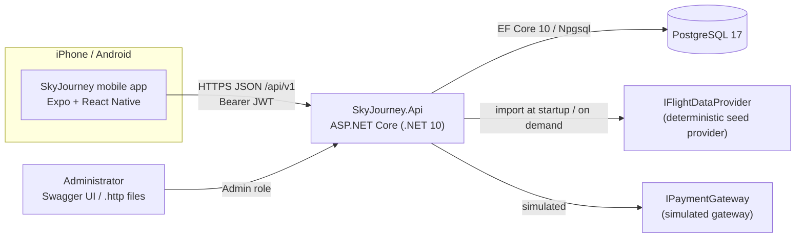
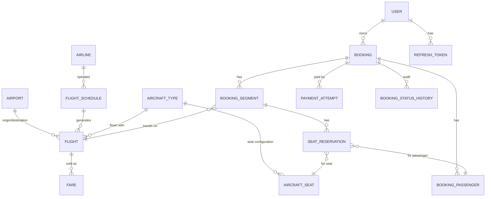
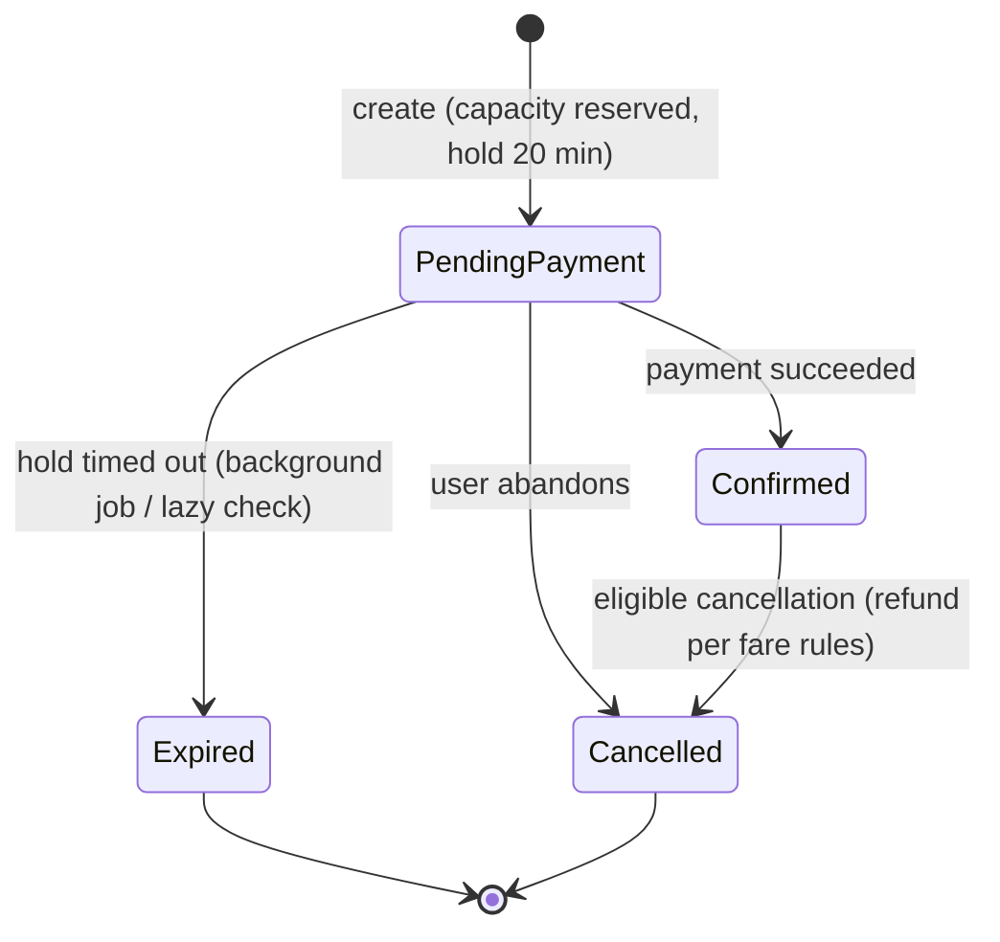

# SkyJourney — Architecture

> Demo application. Airports are real IATA airports, but every airline, flight, fare and
> availability figure is generated by a deterministic mock provider.

## System context



## Backend layering

```
backend/src
  SkyJourney.Domain          entities, value objects, state machines, domain rules (no dependencies)
  SkyJourney.Application     use-case services, DTOs, validators, ports (interfaces)
  SkyJourney.Infrastructure  EF Core DbContext + migrations, Identity, JWT, seed provider, payment simulator, background jobs
  SkyJourney.Api             minimal-API endpoints, auth configuration, ProblemDetails, rate limiting, OpenAPI, composition root
```

Dependencies point inward: `Api → Application → Domain`, and `Infrastructure → Application → Domain`.
`Api` references `Infrastructure` only to wire up dependency injection.

**Pragmatic choices** (see the ADRs):
- Application services take an `ISkyJourneyDbContext` interface that exposes `DbSet<T>`s. There are no
  generic repositories, because EF Core already is a unit of work plus repositories ([ADR-0004](adr/0004-data-access-without-repositories.md)).
- Minimal APIs grouped by feature under `/api/v1`. Endpoints only bind, authorize and call one
  application service method ([ADR-0002](adr/0002-rest-minimal-apis-and-url-versioning.md)).
- Errors use RFC 9457 Problem Details. Domain and application errors map to 400/404/409/422.
- Domain entities create their own UUIDv7 ids, so every `Entity.Id` is mapped `ValueGeneratedNever`. Otherwise EF Core
  would treat a child added to a tracked aggregate (a seat hold, a payment attempt) as existing and issue an `UPDATE`.
- `SaveChangesAsync` translates PostgreSQL unique violations into `UniqueConstraintViolationException` carrying the
  constraint name, so services can map specific indexes to specific errors without depending on Npgsql.

### Booking endpoints (`/api/v1/bookings`, authenticated)

| Method | Path | Result |
|--------|------|--------|
| POST | `/` | Requires `Idempotency-Key`. `201` + `Location` for a new booking, `200` for a replay (`Idempotent-Replayed: true`), `409 insufficient_capacity` / `invalid_itinerary`, `422 idempotency_key_reused` |
| GET | `/` | The caller's bookings, newest first (paged), with `isUpcoming` |
| GET | `/{reference}` | Full booking: passengers, segments with fare snapshot and conditions, seats, totals |
| GET | `/{reference}/segments/{segmentId}/seat-map` | Layout with `Available` / `Occupied` / `Selected` and the price of each seat for the segment's fare |
| PUT | `/{reference}/segments/{segmentId}/seats` | Replaces the listed passengers' seats on that flight; `409 seat_unavailable` / `booking_expired`, `422 seat_not_found` / `passenger_not_in_booking` |
| GET | `/{reference}/cancellation` | Whether cancelling is allowed now and the refund it would give |
| POST | `/{reference}/cancel` | Cancels, releases seats and capacity, records the (simulated) refund |
| POST | `/{reference}/payments` | Body `{ "paymentToken": "sim_success" }`, requires `Idempotency-Key`, rate limited per user. `201` with the attempt and the updated booking (a decline is also `201` with `status: Failed` and a `failureCode`), `200` for a replay, `409 booking_expired` / `booking_not_payable` / `payment_in_progress`, `422 idempotency_key_reused` |

### Payment flow (`PaymentService`)
1. **Claim.** Record a `Pending` attempt and stamp `Booking.LastPaymentStartedAt`. That bumps the booking's `xmin`, so a
   concurrent payment, seat change, cancellation or expiry of the same booking loses with a concurrency conflict.
2. **Charge.** Call `IPaymentGateway` outside any transaction and no longer cancellable by the client.
3. **Record.** Mark the attempt `Succeeded` (confirming the booking and its seats) or `Failed` (booking stays payable).

While an attempt is `Pending` and younger than `Booking.PaymentTimeout` (2 min), the hold cannot expire and the booking
cannot be changed or cancelled (`409 payment_in_progress`). An older pending attempt is treated as abandoned: it is marked
`Failed` (`payment_timeout`) by the next payment, cancellation or expiry.

A booking whose flight has been cancelled by the airline cannot be paid (`409 flight_cancelled`). This guard covers
a booking that a flight cancellation skipped because a payment was in progress at that moment.

### Admin API (`/api/v1/admin`, `Admin` role)
Anonymous callers get `401` and signed-in non-admins get `403`. Responses carry the booking owner's user id, but no
contact details.

| Area | Routes | Notes |
|------|--------|-------|
| Airports | `GET /airports`, `POST /airports`, `PUT /airports/{iata}`, `POST /airports/{iata}/activate` / `deactivate` | Airports are never deleted. Deactivating hides an airport from search and new schedules; existing flights are unaffected. |
| Schedules | `GET /schedules`, `POST /schedules` | Creating a schedule generates its flights for today plus `HorizonDays` straight away. Overlapping dates for one flight number are `409 schedule_overlap`. Schedules are create-only, because editing a timetable with sold flights is a re-accommodation problem that is out of scope. |
| Flights | `GET /flights` (date, route, number, status), `GET /flights/{id}`, `PUT /flights/{id}/fares/{family}`, `POST /flights/{id}/cancel` | A fare change applies to new bookings only (fare snapshot). |
| Bookings | `GET /bookings` (reference, flight, user, status), `GET /bookings/{reference}` (with history and payment attempts), `POST /bookings/{reference}/cancel` | |

**Flight cancellation** (`AdminFlightService.CancelAsync`) runs in three steps and is safe to repeat:
1. Commit `Flight.Status = Cancelled`. From then on, `FlightCapacity` refuses reservations, because it checks the
   status in the same statement, and `PaymentService` refuses payments.
2. Expire lapsed holds on the flight.
3. Cancel each `PendingPayment` or `Confirmed` booking in its own transaction, as `BookingActor.Administrator`, with a
   full simulated refund. Bookings with a payment in progress, or ones changed concurrently, are returned as `skipped`;
   calling the endpoint again processes them.

### Background jobs (`Infrastructure/Jobs`, `BackgroundJobs` settings)
| Job | Default interval | Work |
|-----|------------------|------|
| `BookingExpiryJob` | 1 min | Expires lapsed holds in batches of 200 (requests also do this lazily per flight) |
| `FlightHorizonJob` | 6 h | Generates flights up to `FlightData:HorizonDays` ahead so the bookable window rolls forward |

Both run once at start-up and are idempotent, so running several API instances is safe (conflicts are ignored).
`BackgroundJobs:Enabled=false` turns them off (tests run them explicitly).

## Domain model



| Entity | Notes |
|--------|-------|
| `Airport` | Unique 3-letter IATA code, IANA time zone ID (`Europe/Budapest`), city and country. |
| `Airline` | Fictional operator (`SkyJourney Air`, code `SJ`). |
| `AircraftType` + `AircraftSeat` | The seat configuration: rows × letters, each seat with a category (Standard, Front, ExtraLegroom). |
| `FlightSchedule` | A recurring pattern: flight number, route, local departure time, duration, days of week, validity window. |
| `Flight` | A concrete flight instance: UTC departure and arrival, `DepartureLocalDate` (the origin airport's local date, used by search), capacity, `SeatsSold` counter, status. Unique `(FlightNumber, DepartureLocalDate)`. |
| `Fare` | Per flight and fare family (Basic/Plus/Flex): price (`numeric(10,2)` + ISO currency) and conditions (cabin bag, checked bag kg, free seat selection, refund percentage). |
| `Booking` | Public 6-character reference, owner user ID, status, totals, hold expiry, idempotency key, `xmin` concurrency token. |
| `BookingSegment` | One flight within a booking (Outbound/Return). Holds a **snapshot** of the fare price and conditions at booking time. |
| `BookingPassenger` | Minimal PII: first name, last name, passenger type (Adult/Child). |
| `SeatReservation` | Seat hold or confirmation for passenger × segment. A **partial unique index** on `(flight_id, aircraft_seat_id) WHERE status IN ('Held','Confirmed')` makes double-selling impossible. |
| `PaymentAttempt` | A simulated payment with an idempotency key, status and failure reason. Never stores card data. |
| `BookingStatusHistory` | An append-only audit trail of status transitions. |
| `RefreshToken` | A SHA-256 hash of the opaque token, token family, expiry and revocation (used for rotation and reuse detection). |

### Booking state machine



Payment attempts go `Pending → Succeeded | Failed`. A succeeded payment can then go to `Refunded` or
`PartiallyRefunded` when its booking is cancelled.

### Cancellation rules (enforced in `Booking.Cancel`)
- `PendingPayment` bookings can always be cancelled. Nothing was charged, so nothing is refunded.
- A `Confirmed` booking can be cancelled up to **24 hours before the first departure**.
- The refund for each segment is `fare paid × refund percentage` of its snapshotted fare family:
  Basic 0%, Plus 50%, Flex 100%. Seat fees are refunded only on Flex segments.
- An admin can cancel any active booking with a full refund, ignoring the 24-hour cutoff and fare rules (for example,
  when a flight is cancelled). The history records the `Administrator` actor and the reason.
- Cancelling releases the seats and decrements `Flight.SeatsSold`.

## Concurrency and consistency

| Risk | Control |
|------|---------|
| Overselling flight capacity | An atomic conditional update: `UPDATE flights SET seats_sold = seats_sold + n WHERE id = @id AND seats_sold + n <= capacity`. If no row is affected, the flight is sold out. This runs in the same transaction as the booking insert. |
| The same seat sold twice | A partial unique index on active seat reservations. A violation (`23505`) maps to `409 seat_unavailable`. Before seats are assigned or a booking is created, lapsed holds on the affected flights are expired (lazy expiry, below). |
| Payment racing the hold expiry | `Booking` uses PostgreSQL `xmin` as an optimistic concurrency token. The losing transaction gets a `DbUpdateConcurrencyException`, which maps to `409`. |
| Duplicate bookings from retries | The `Idempotency-Key` header is required. There is a unique `(user_id, idempotency_key)` index plus a request hash: the same key with the same body returns the original booking, and the same key with a different body returns `422`. |
| Lapsed holds still blocking seats | **Lazy expiry**: booking creation, seat selection and cancellation first expire due `PendingPayment` bookings on the affected flights, each in its own short transaction (a concurrency conflict means another request got there first and is ignored). Reads report a lapsed hold as `Expired` even before it is persisted. `BookingExpiryJob` sweeps the rest every minute. |
| Duplicate payments | `Idempotency-Key` with a unique `(booking_id, idempotency_key)` index and a request hash. Starting a payment bumps the booking version, so parallel attempts with different keys get `409 payment_in_progress` and only one can charge. A booking can only be confirmed once. |
| Hold expiring during a charge | A pending attempt younger than `Booking.PaymentTimeout` keeps the hold alive (the expiry query and `IsHoldExpired` skip it). If a charge somehow outlives that window and the booking changed, recording fails, the client gets `409 payment_timeout` and an error is logged for a refund. |

## Time handling
- Persisted instants are `timestamptz` (`DateTimeOffset` in UTC).
- Each airport stores an IANA time zone. Schedules store a **local** departure time. A flight's UTC
  departure is computed with `TimeZoneInfo` for that specific date, so DST is handled.
- The API returns both the UTC instant and the airport-local time with its offset
  (`2026-11-02T07:05:00+01:00`), so clients never have to do time-zone math.
- `TimeProvider` is injected everywhere, so tests control the clock.

## Security
- ASP.NET Core Identity handles password hashing and lockout. Access tokens are short-lived JWTs (15 min).
  Refresh tokens are opaque, rotated on every use, and stored only as SHA-256 hashes. Reusing a token revokes the whole family ([ADR-0003](adr/0003-authentication-jwt-and-rotating-refresh-tokens.md)).
- `Admin` role policy for `/api/v1/admin/*`. Admins are provisioned with a CLI command, never through config or an endpoint:
  `dotnet run --project backend/src/SkyJourney.Api -- promote-admin user@example.com` (the account must exist).
  The role reaches existing sessions on their next token refresh.
- The JWT signing key comes from `Jwt__SigningKey` (≥ 32 bytes). Production refuses to start without it. Development
  and tests generate a random per-process key, so access tokens die on restart and clients silently refresh.
- Login failures return the same `401 invalid_credentials` for unknown e-mails and wrong passwords (a dummy hash is
  verified in both cases). Five failures lock the account for 15 minutes (`401 account_locked`). Registration does
  reveal that an e-mail is taken (`409 email_taken`); that is accepted for usability, and the endpoint is rate limited.
- Refresh-token reuse detection is strict: two refreshes racing with the same token count as reuse and end the
  session. The mobile client therefore refreshes single-flight.
- Every booking query is filtered by the authenticated user's ID. Another user's booking returns `404` (no IDOR, no existence leak).
- Prices, totals, status and seat availability are always computed on the server.
- Rate limiting (fixed window, `RateLimiting` settings, `429 rate_limited` with `Retry-After`) covers auth endpoints per client IP and payments per signed-in user. Behind a proxy, forwarded headers must be configured so the real client IP is used (see deployment docs). Request logging never includes bodies or the `Authorization` header.
- Production returns Problem Details without stack traces. Secrets come from environment variables or user-secrets.

## Mobile architecture

```
mobile/SkyJourney.Mobile/src
  app/                 Expo Router routes (file-based navigation)
    (tabs)/            Search, Trips, Profile
    search/            results, flight details
    booking/           passengers, [reference]/seats, [reference]/checkout, [reference]/confirmation
    trips/             [reference] (booking details and cancellation)
    auth/              login, register
  api/                 typed fetch client (Problem Details → ApiError), endpoints, query client
  auth/                AuthProvider, SecureStore token persistence, refresh single-flight
  booking/             booking-draft context, idempotency keys, seat-map layout, hold countdown, booking gate
  components/          design system (Button, Card, TextField, Screen, loading/empty/error states)
  trips/               booking status presentation
  lib/                 formatting (airport-local times), network status
  theme/               colors, spacing, typography tokens
```

Routes live in `src/app` (the Expo SDK 57 template convention) and imports use the `@/` alias for `src/`.

- **Server state** lives in TanStack Query. **Draft state** (criteria, selected flights) lives in a React context.
- The API base URL is resolved at runtime: `EXPO_PUBLIC_API_URL` if set. Otherwise, in development,
  the host of the Metro bundler (works on a physical iPhone on the same Wi-Fi), falling back to `localhost` on the
  iOS simulator and `10.0.2.2` on the Android emulator. The API listens on port 5080.
- Offline handling: NetInfo feeds TanStack Query's `onlineManager`, so queries pause offline and refetch on reconnect;
  every screen shows an offline banner. Only network errors and 5xx responses are retried.
- Airport-local times are displayed by reading the wall-clock part of the API's offset-qualified ISO strings, never by
  converting to the phone's time zone.
- The refresh token is stored in SecureStore (iOS Keychain / Android Keystore). The access token stays in memory only.

### Booking flow (mobile)

`search/summary` → `booking/passengers` (sign-in required) → `booking/[reference]/seats` → `booking/[reference]/checkout`
→ `booking/[reference]/confirmation`.

- **The server owns prices and state.** Each screen after creation reads the booking by reference;
  `PendingBookingGate` renders the step only while the booking is `PendingPayment`. It redirects confirmed bookings to
  the confirmation screen and explains expired or cancelled ones. A banner counts down the hold. When the hold reaches
  zero, the banner reloads the booking so the server decides the outcome.
- **Idempotency keys.** Requests that create something carry an `Idempotency-Key` from `createIdempotencyKeys`, which
  returns the same key for the same request body until it is reset.
  - The create-booking keys live in the draft context, so pressing Continue again after going back replays the same
    booking instead of creating a second one.
  - The checkout screen keeps its own payment keys.
  - Keys are reset after a definite outcome: a recorded payment (approved or declined) or a 4xx. They are kept after a
    network error or 5xx, when the server may have processed the request. The retry then replays it rather than paying
    twice.
- **Seats** are saved one passenger at a time (`PUT …/seats` with one assignment); selection then moves to the next
  passenger without a seat. A conflict (`seat_unavailable`) shows a message, and the seat map is reloaded after every
  attempt. Seat selection is optional.
- **Trips and cancellation.** The Trips tab pages through `GET /bookings` with an infinite query, newest first, and
  supports pull-to-refresh. Booking details offer to continue paying while a hold is running. They also offer a
  two-step cancellation: the first press loads the server's quote, which says whether the booking can be cancelled
  and the refund under the fare rules; the second press cancels. The app never computes refunds itself.
- **Payment** only offers the simulated test tokens; the app never asks for card details. A decline leaves the booking
  payable. Any payment error reloads the booking, so an expired hold is shown as expired.

## Deployment (prepared, not deployed)
- The API ships as a multi-stage Docker image running as the non-root `app` user.
- The recommended hosting is a container platform with managed PostgreSQL; options are compared in `docs/deployment.md`.
- Migrations run as an explicit release step (an EF Core migration bundle), never on production app startup.
- Mobile builds use Expo EAS (development, preview and production profiles). TestFlight first, then Google Play internal testing.
